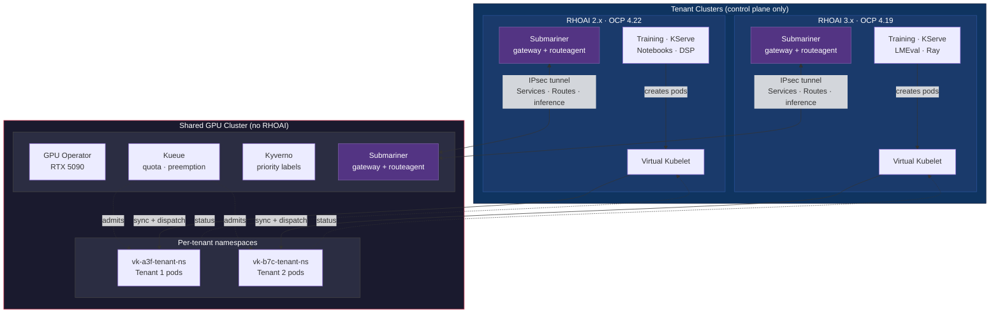
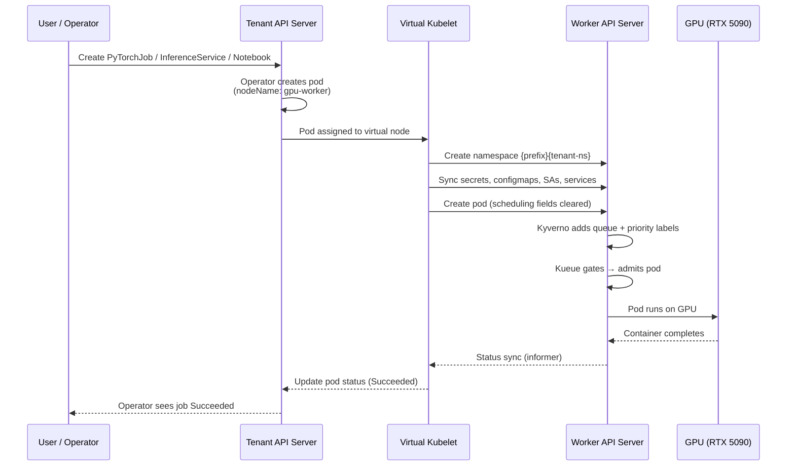

# GPUaaS Virtual Kubelet Spike

## Can we decouple GPU execution from the RHOAI control plane so multiple tenants share a GPU cluster governed by Kueue?

**Yes.** Virtual Kubelet makes it work. The RHOAI control plane (operators,
CRDs, dashboards) stays on each tenant. Only bare compute pods land on the
shared GPU worker — no RHOAI installed there, just GPU Operator + Kueue.



### What the spike proves

| Claim | How it was validated |
|-------|---------------------|
| **RHOAI version doesn't matter** | RHOAI 2.x (OCP 4.22) and 3.x (OCP 4.19) both dispatch to the same GPU worker. |
| **Tenants run in parallel** | Both suites run simultaneously on the same GPU — no coordination, no awareness of each other. |
| **All major workloads work** | PyTorchJob, KServe, Notebooks, XGBoostJob, TFJob, RayJob, LMEval, DSP — no RHOAI modifications needed. |
| **Kueue enforces quota** | GPU admission, queuing, and cross-tenant preemption all work. Priority is admin-controlled. |
| **Networking works** | Services and inference endpoints reach GPU pods via Submariner. Tunnel self-heals after failure. |
| **Distributed training works** | Headless Service sync enables inter-pod DNS on the worker. Validated for the mechanism; full multi-GPU deferred (lab has 1 GPU). |
| **Worker stays bare** | No RHOAI CRDs or operators on the GPU cluster. |

### What it doesn't prove (yet)

- Full multi-GPU distributed training (mechanism works, need >1 GPU to test end-to-end)
- KServe with full Istio service mesh — Knative dispatch works (S20, RHOAI 2.x), but Istio sidecar injection must be disabled (no Istio control plane on worker). RHOAI 3.x dropped Knative/OSSM entirely and uses RawDeployment exclusively (already validated).
- RBAC sync across clusters (by design — avoids privilege escalation)
- Production HA (single-node clusters in lab)

Full spike assessment with all 22 validated scenarios:
[docs/spike-assessment.md](docs/spike-assessment.md)

---

## How it works

A custom Virtual Kubelet provider runs on each tenant cluster and registers
a virtual node (`gpu-worker`) advertising GPU capacity. When a pod targets
that node, VK:

1. Creates a per-tenant namespace on the worker (`{prefix}{tenant-ns}`)
2. Syncs referenced secrets, configmaps, service accounts, headless services, and PVCs
3. Creates the pod on the worker GPU cluster
4. Syncs status back to the tenant so operators see success/failure

Users and operators don't know the pod ran elsewhere. The training operator
creates a PyTorchJob, the pod runs on a remote GPU, status comes back —
the operator marks the job Succeeded.



## Lab setup

### Prerequisites

See [00-prerequisites.md](00-prerequisites.md) for hardware-specific setup
(VFIO, IOMMU, QEMU 9.2 build, libvirt memlock, RTX 5090 XML tweaks).

### Provisioning

```bash
ansible-playbook -i inventory.yml playbooks/01-create-vms.yml
ansible-playbook -i inventory.yml playbooks/02-wait-and-discover.yml
ansible-playbook -i inventory.yml playbooks/03-configure-clusters.yml
ansible-playbook -i inventory.yml playbooks/04-setup-virtual-kubelet.yml
ansible-playbook -i inventory.yml playbooks/05-setup-submariner.yml
```

After provisioning, kubeconfigs are at `~/.kube/tenant` and `~/.kube/worker`.

### Playbooks

| Playbook | What it does |
|----------|-------------|
| `01-create-vms.yml` | Creates libvirt VMs, generates install-config, starts SNO install |
| `02-wait-and-discover.yml` | Waits for install to complete, discovers API endpoints |
| `03-configure-clusters.yml` | Installs GPU Operator, Kueue, LVMS on worker; RHOAI on tenant |
| `04-setup-virtual-kubelet.yml` | Builds VK image, sets up worker namespace/RBAC/Kueue queues, deploys VK on tenant |
| `05-setup-submariner.yml` | Installs subctl, deploys Submariner broker on GPU cluster, joins both clusters |
| `teardown.yml` | Destroys VMs and cleans up |

### Teardown

```bash
ansible-playbook -i inventory.yml playbooks/teardown.yml
```

## Running tests

```bash
# RHOAI 2.x suite (VK core + RHOAI + networking + Kueue)
TENANT_KUBECONFIG=~/.kube/tenant WORKER_KUBECONFIG=~/.kube/worker \
  python -m pytest tests/ -v

# RHOAI 3.x suite
python -m pytest tests/rhoai_3/e2e/ -v

# By marker
python -m pytest tests/ -v -m vk           # core dispatch
python -m pytest tests/ -v -m rhoai        # RHOAI operator integration
python -m pytest tests/ -v -m networking   # Submariner
python -m pytest tests/ -v -m kueue        # multi-tenant quota
```

## VK provider

Go binary in `cmd/vk-gpu-provider/`, built on `virtual-kubelet/virtual-kubelet` v1.11.0.

```bash
podman build -t quay.io/jmorenas/gpuaas-virtual-kubelet:latest -f cmd/vk-gpu-provider/Dockerfile .
podman push quay.io/jmorenas/gpuaas-virtual-kubelet:latest
```

<details>
<summary>CLI flags</summary>

| Flag | Default | Description |
|------|---------|-------------|
| `--nodename` | `gpu-worker` | Name of the virtual node |
| `--worker-kubeconfig` | *(required)* | Path to worker cluster kubeconfig |
| `--kubeconfig` | *(in-cluster)* | Path to tenant cluster kubeconfig |
| `--gpu-count` | `1` | Number of GPUs to advertise |
| `--worker-namespace-prefix` | *(auto-generated)* | Prefix for per-tenant worker namespaces |
| `--default-remote-storage-class` | `lvms-vg1` | StorageClass for execution PVCs on the GPU cluster |
| `--taint-value` | `catapult` | Value for the `virtual-kubelet.io/provider` taint |
| `--insecure-skip-tls-verify` | `false` | Skip TLS certificate verification for API servers |
| `--kubelet-cert` | *(none)* | PEM file with cert+key for kubelet API TLS (enables `kubectl logs`) |
| `--kubelet-port` | `10350` | Port for the kubelet API server (must differ from real kubelet 10250) |

</details>

<details>
<summary>Resource sync details</summary>

VK discovers resource references by walking the pod spec:

| Reference type | Fields scanned |
|---------------|---------------|
| Secrets | `env[].valueFrom.secretKeyRef`, `envFrom[].secretRef`, `volumes[].secret`, `imagePullSecrets` |
| ConfigMaps | `env[].valueFrom.configMapKeyRef`, `envFrom[].configMapRef`, `volumes[].configMap` |
| ServiceAccounts | `serviceAccountName` (plus the SA's image pull secrets) |
| Headless Services | Services with `clusterIP: None` whose selector matches the pod |
| PVCs | Only `storageClassName: catapult` — see [docs/pvc-architecture.md](docs/pvc-architecture.md) |

Synced resources get management labels (`app.kubernetes.io/managed-by: vk-gpu-provider`,
`vk.gpuaas.io/source-pod`, `vk.gpuaas.io/source-namespace`) for cleanup tracking.

</details>
