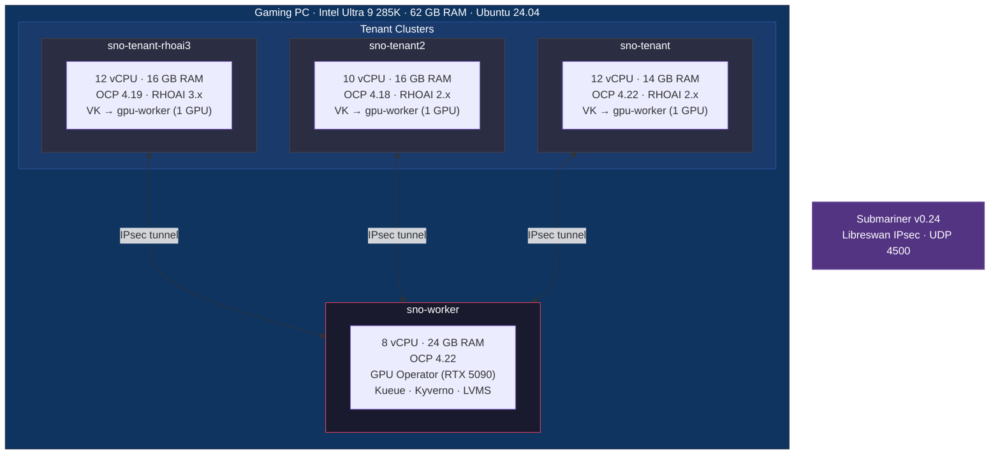
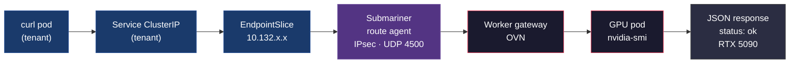

# Virtual Kubelet GPU Dispatch — Spike Assessment

## Objective

Prove that a custom Virtual Kubelet can transparently dispatch GPU workloads
from tenant OpenShift clusters (running RHOAI) to a bare worker cluster with
physical GPUs. Tenants can run different OCP and RHOAI versions, sharing the
same GPU pool without interference. Cross-cluster networking via Submariner
enables Services and Routes to reach remote GPU pods.

## Lab Environment



| Component | Tenant (sno-tenant) | Tenant 2 (sno-tenant2) | Tenant RHOAI3 (sno-tenant-rhoai3) | Worker (sno-worker) |
|-----------|--------------------|-----------------------|----------------------------------|---------------------|
| OpenShift | 4.22 | 4.18 | 4.19 | 4.22 |
| vCPU / RAM | 12 / 14 GB | 10 / 16 GB | 12 / 16 GB | 8 / 24 GB |
| GPU | — | — | — | RTX 5090 (32 GB VRAM) |
| RHOAI | 2.25 | 2.25 | 3.5 | — |
| Operators | RHOAI, OSSM 2.x, Serverless | RHOAI, OSSM 2.x, Serverless | RHOAI, cert-manager, jobset, Kyverno | GPU Operator, Kueue, Kyverno, LVMS |
| Pod CIDR | 10.128.0.0/14 | 10.136.0.0/14 | 10.140.0.0/14 | 10.132.0.0/14 |
| Service CIDR | 172.30.0.0/16 | 172.32.0.0/16 | 172.33.0.0/16 | 172.31.0.0/16 |
| Networking | Submariner v0.24 | Submariner v0.24 | Submariner v0.24 | Submariner v0.24 |

All clusters run as single-node OpenShift on libvirt VMs on a gaming PC
(Intel Core Ultra 9 285K, 62 GB RAM, Ubuntu 24.04).

## How to Run

All tests are integration tests that run against live clusters. Each test
creates its own resources, waits for the expected outcome, asserts, and
cleans up.

### Prerequisites

```bash
pip install kubernetes pytest
export TENANT_KUBECONFIG=~/.kube/tenant
export WORKER_KUBECONFIG=~/.kube/worker
```

### Run all scenarios

```bash
python -m pytest tests/ -v
```

### Run by category

```bash
python -m pytest tests/ -v -m vk            # Core dispatch + resource sync + storage + logs
python -m pytest tests/ -v -m rhoai         # RHOAI integration
python -m pytest tests/ -v -m networking    # Cross-cluster networking (Submariner)
python -m pytest tests/ -v -m kueue         # Kueue admission + preemption (needs both tenants)
```

### Run Kueue tests (requires both tenants + Kueue + Kyverno on worker)

```bash
TENANT_KUBECONFIG=~/.kube/tenant TENANT2_KUBECONFIG=~/.kube/tenant2 \
  WORKER_KUBECONFIG=~/.kube/worker \
  python -m pytest tests/test_kueue_vk.py -v
```

The `kueue_setup` fixture auto-installs Kueue and Kyverno on the worker if
missing, applies policies and RBAC, creates the ClusterQueue, and patches
the Kueue webhook for reinvocation.

### Run against second tenant (OCP 4.18)

```bash
TENANT_KUBECONFIG=~/.kube/tenant2 WORKER_KUBECONFIG=~/.kube/worker \
  python -m pytest tests/ -v -m vk
```

---

## Scenarios Assessed

### 1. Core Dispatch

#### S1. Virtual node registration

| | |
|---|---|
| **Test** | `test_vk_gpu.py::test_virtual_node_exists` |
| **What** | VK registers a virtual node `gpu-worker` on the tenant with `nvidia.com/gpu` in allocatable and Ready condition |
| **Result** | PASS |
| **Proves** | Tenant scheduler sees GPU capacity and can assign pods to the virtual node |

**How to run:**
```bash
python -m pytest tests/test_vk_gpu.py::test_virtual_node_exists -v
```

**What to look for:** The test reads the `gpu-worker` node object and checks:
- Label `type=virtual-kubelet` exists
- `nvidia.com/gpu` is in `status.allocatable`
- Node condition `Ready=True`

---

#### S2. GPU pod dispatch and status sync

| | |
|---|---|
| **Test** | `test_vk_gpu.py::test_gpu_pod_dispatched_via_vk` |
| **What** | GPU pod submitted on tenant with `nodeName: gpu-worker` → VK creates pod on worker → `nvidia-smi` runs on RTX 5090 → status (Phase, exit code) synced back to tenant as Succeeded |
| **Result** | PASS |
| **Proves** | End-to-end dispatch works: pod scheduled on virtual node executes on real GPU, status is visible on tenant |

**How to run:**
```bash
python -m pytest tests/test_vk_gpu.py::test_gpu_pod_dispatched_via_vk -v
```

**What to look for:** The test:
1. Creates a pod with `image: nvcr.io/nvidia/cuda:12.8.0-base-ubi9`, `command: nvidia-smi`, requesting 1 GPU
2. Waits for the worker pod (`{namespace}--{name}`) to appear in the worker namespace
3. Waits for worker pod phase to reach `Succeeded` (nvidia-smi exits 0)
4. Verifies the tenant pod also shows `Succeeded` (status synced back by VK informer)
5. Checks container exit code is 0

---

### 2. Resource Isolation

#### S3. Secret and ConfigMap sync

| | |
|---|---|
| **Test** | `test_vk_gpu.py::test_resource_sync` |
| **What** | Pod references a Secret (via `secretKeyRef`) and ConfigMap (via volume mount) on tenant → VK syncs both to worker with management labels → pod reads them successfully |
| **Result** | PASS |
| **Proves** | VK discovers resource references by walking the pod spec and syncs them on-demand. No pre-staging required. |

**How to run:**
```bash
python -m pytest tests/test_vk_gpu.py::test_resource_sync -v
```

**What to look for:** The test:
1. Creates a Secret (`MY_SECRET=hello-from-tenant`) and ConfigMap (`config.txt=value-from-tenant`) on the tenant
2. Creates a pod that reads the secret via `env[].valueFrom.secretKeyRef` and the configmap via a volume mount
3. Verifies both resources appear on the worker with label `app.kubernetes.io/managed-by: vk-gpu-provider`
4. Verifies the pod succeeds (meaning it could read both resources)

---

#### S4. Pod deletion cleanup

| | |
|---|---|
| **Test** | `test_vk_gpu.py::test_pod_deletion_cleans_up` |
| **What** | Tenant pod deleted → worker pod deleted → synced secret cleaned up (verified via 404) |
| **Result** | PASS |
| **Proves** | No resource leaks. Management labels enable targeted cleanup. |

**How to run:**
```bash
python -m pytest tests/test_vk_gpu.py::test_pod_deletion_cleans_up -v
```

**What to look for:** The test:
1. Creates a secret + pod on the tenant, waits for the worker pod to appear
2. Deletes the tenant pod
3. Verifies the worker pod is deleted (404)
4. Verifies the synced secret is also cleaned up (404)

---

### 3. Storage

#### S5. Catapult PVC sync

| | |
|---|---|
| **Test** | `test_vk_gpu.py::test_catapult_pvc_sync` |
| **What** | PVC with `storageClassName: catapult` on tenant → execution PVC created on worker with namespace-prefixed name (`{ns}--{name}`) and LVMS StorageClass → execution PVC survives pod deletion → cleaned up when control PVC deleted |
| **Result** | PASS |
| **Proves** | PVC lifecycle is independent of pod lifecycle. Data persists across pod restarts. Cleanup is automatic via PVC deletion informer. |

**How to run:**
```bash
python -m pytest tests/test_vk_gpu.py::test_catapult_pvc_sync -v
```

**What to look for:** The test:
1. Creates a PVC with `storageClassName: catapult` and a pod that mounts it
2. Verifies execution PVC (`{namespace}--{pvc_name}`) appears on worker with management labels
3. Verifies execution PVC has `ReadWriteOnce` access mode and correct source labels
4. Deletes the tenant pod — verifies execution PVC **survives** (data persists)
5. Deletes the control PVC — verifies execution PVC is cleaned up

---

#### S6. Non-catapult PVC rejection

| | |
|---|---|
| **Test** | `test_vk_gpu.py::test_non_catapult_pvc_rejected` |
| **What** | Pod referencing PVC without `storageClassName: catapult` → pod marked Failed with reason `InvalidPVCStorageClass` → no execution PVC created on worker |
| **Result** | PASS |
| **Proves** | Only explicitly opted-in PVCs are synced. Clear error message for users. |

**How to run:**
```bash
python -m pytest tests/test_vk_gpu.py::test_non_catapult_pvc_rejected -v
```

**What to look for:** The test:
1. Creates a PVC without the `catapult` StorageClass and a pod that mounts it
2. Verifies the tenant pod reaches `Failed` with reason `InvalidPVCStorageClass`
3. Verifies no execution PVC exists on the worker (404)

---

### 4. RHOAI Integration

#### S7. PyTorchJob training dispatch

| | |
|---|---|
| **Test** | `test_rhoai_vk.py::test_pytorchjob_via_vk` |
| **What** | PyTorchJob CR on tenant → RHOAI training operator creates master pod → VK dispatches to worker GPU → `nvidia-smi` succeeds → status synced → PyTorchJob condition reaches Succeeded |
| **Result** | PASS |
| **Proves** | RHOAI training operator works transparently. It creates pods, VK dispatches them, status syncs back, and the operator sees Succeeded. No RHOAI modifications needed. |

**How to run:**
```bash
python -m pytest tests/test_rhoai_vk.py::test_pytorchjob_via_vk -v
```

**What to look for:** The test:
1. Creates a PyTorchJob CR with 1 master replica targeting the virtual node
2. Waits for the training operator to create the master pod (`{job_name}-master-0`)
3. Waits for the worker pod to appear and succeed (nvidia-smi on RTX 5090)
4. Verifies the tenant pod shows `Succeeded`
5. Verifies the PyTorchJob CR has condition `Succeeded=True`

---

#### S8. Worker stays bare

| | |
|---|---|
| **Test** | `test_rhoai_vk.py::test_no_rhoai_crds_on_worker` |
| **What** | Worker cluster has no RHOAI CRDs (pytorchjobs, notebooks, inferenceservices, rayclusters) |
| **Result** | PASS |
| **Proves** | Worker is a bare GPU execution node. No operator stack duplication. RHOAI runs only on tenant. |

**How to run:**
```bash
python -m pytest tests/test_rhoai_vk.py::test_no_rhoai_crds_on_worker -v
```

**What to look for:** The test lists all CRDs on the worker and asserts that none of the RHOAI CRDs
(`pytorchjobs.kubeflow.org`, `notebooks.kubeflow.org`, `inferenceservices.serving.kserve.io`,
`rayclusters.ray.io`) are present.

---

#### S16. Real PyTorch GPU training

| | |
|---|---|
| **Test** | `test_rhoai_vk.py::test_pytorchjob_real_training` |
| **What** | PyTorchJob with inline training script (5-epoch MLP: forward pass, backward pass, optimizer step) runs on RTX 5090 via VK → training uses CUDA → all epochs complete → Succeeded |
| **Result** | PASS |
| **Proves** | Actual CUDA compute works end-to-end through VK, not just `nvidia-smi` device enumeration. PyTorch forward/backward passes, gradient computation, and optimizer steps all execute on the remote GPU. |

**How to run:**
```bash
python -m pytest tests/test_rhoai_vk.py::test_pytorchjob_real_training -v
```

**What to look for:** The test:
1. Creates a PyTorchJob with an inline training script: `nn.Sequential(Linear(784,128), ReLU(), Linear(128,10))` trained for 5 epochs on random data
2. Waits for master pod, worker pod dispatch, and completion
3. Verifies logs contain `Training on: cuda` (GPU was used)
4. Verifies logs contain `Training complete` and `Epoch 5` (all epochs ran)
5. Verifies tenant pod status synced to `Succeeded`
6. Verifies PyTorchJob CR condition `Succeeded=True`

**Note:** RTX 5090 (Blackwell, compute capability sm_120) requires PyTorch 2.7+
built against CUDA 12.8+. Image: `pytorch/pytorch:2.11.0-cuda12.8-cudnn9-runtime`.
Earlier CUDA builds (12.6 and below) fail with `cudaErrorNoKernelImageForDevice`.

---

#### S17. Training checkpoint persistence with catapult PVC

| | |
|---|---|
| **Test** | `test_rhoai_vk.py::test_pytorchjob_checkpoint_with_pvc` |
| **What** | PyTorchJob trains on GPU → saves model checkpoint to catapult PVC (`torch.save`) → verification pod loads checkpoint (`torch.load`) from same PVC → checkpoint is valid |
| **Result** | PASS |
| **Proves** | The core data pipeline for long-running training works: train → checkpoint → persist. Catapult PVCs survive pod completion and can be re-mounted by subsequent pods. |

**How to run:**
```bash
python -m pytest tests/test_rhoai_vk.py::test_pytorchjob_checkpoint_with_pvc -v
```

**What to look for:** The test:
1. Creates a catapult PVC `training-checkpoint` on the tenant
2. Creates a PyTorchJob that trains a model and saves `torch.save(model.state_dict(), '/data/checkpoint.pt')`
3. Waits for training to complete (`Succeeded`)
4. Verifies execution PVC exists on worker with management labels
5. Creates a verification pod (also via VK) that mounts the same PVC and runs `torch.load('/data/checkpoint.pt', weights_only=True)` — prints number of keys and `Checkpoint valid`
6. Waits for verification pod `Succeeded`
7. Reads logs — verifies `Checkpoint valid` and key count > 0
8. Cleanup: deletes pods and control PVC (triggers execution PVC cleanup)

---

#### S18. RHOAI Notebook CR via VK

| | |
|---|---|
| **Test** | `test_rhoai_vk.py::test_notebook_cr_via_vk` |
| **What** | Notebook CR on tenant → Kubeflow notebook controller creates StatefulSet → StatefulSet creates pod → VK dispatches to worker → GPU HTTP server runs on RTX 5090 → Notebook CR status shows Ready |
| **Result** | PASS |
| **Proves** | The full Dashboard → Notebook → GPU workflow works via VK. Data scientists can create Notebooks from the RHOAI Dashboard and get GPU access on the remote worker cluster transparently. |

**How to run:**
```bash
python -m pytest tests/test_rhoai_vk.py::test_notebook_cr_via_vk -v
```

**What to look for:** The test:
1. Creates a Notebook CR targeting the virtual node with VK tolerations
2. Waits for the notebook controller to create a StatefulSet
3. Waits for the StatefulSet to create a pod (`vk-gpu-notebook-0`)
4. Waits for VK to dispatch the pod to the worker
5. Verifies the container is Running on the worker (GPU HTTP server)
6. Verifies tenant pod status synced to Running
7. Verifies Notebook CR status shows Ready condition or running containerState

**Lab note:** Requires ~28GB RAM on the tenant SNO so the notebook controller
can schedule. With default 14GB, RHOAI components cause memory pressure and
the controller stays Pending. See test docstring for VM memory adjustment steps.

---

#### S19. KServe raw inference via VK

| | |
|---|---|
| **Test** | `test_rhoai_vk.py::test_kserve_inference_via_vk` |
| **What** | KServe InferenceService CR (raw deployment mode) → KServe controller creates Deployment → Deployment creates pod → VK dispatches to worker → inference server runs on RTX 5090 GPU |
| **Result** | PASS |
| **Proves** | The RHOAI-native model serving API works through VK. KServe creates a Deployment from the InferenceService CR, the pod gets dispatched to the worker GPU, and the inference server runs. The full operator stack (ServiceMesh + Serverless + KServe) is installed and managed automatically by RHOAI. |

**How to run:**
```bash
python -m pytest tests/test_rhoai_vk.py::test_kserve_inference_via_vk -v
```

**What to look for:** The test:
1. Enables OperatorHub default catalog sources if disabled (`disableAllDefaultSources: false`)
2. Installs ServiceMesh operator Subscription if not present (redhat-operators catalog)
3. Installs Serverless operator Subscription + OperatorGroup if not present
4. Waits for both operator CSVs to reach `Succeeded` phase
5. Waits for RHOAI to automatically create the KServe infrastructure (SMCP `data-science-smcp`, KnativeServing, KServe controller) — detects readiness via InferenceService CRD appearing
6. Creates an InferenceService CR with `serving.kserve.io/deploymentMode: RawDeployment` targeting the VK node
7. Waits for KServe controller to create a Deployment
8. Waits for the Deployment to create a pod (via ReplicaSet)
9. Verifies the pod is dispatched to the worker (worker pod appears)
10. Verifies the worker pod reaches Running (inference server on GPU)
11. Checks InferenceService Ready condition (non-fatal warning if not Ready — status sync lag)

**Note:** First run takes 5-10 minutes for operator installs + CRD propagation.
Subsequent runs with operators already installed take ~30 seconds. Requires
~28GB RAM on the tenant SNO (ServiceMesh + Serverless + RHOAI components).
RHOAI DSCInitialization has `serviceMesh.managementState: Managed` — it
automatically creates SMCP, ServiceMeshMember, and KnativeServing when the
prerequisite operators are installed.

---

#### S20. KServe serverless inference via VK (Knative)

| | |
|---|---|
| **Test** | `test_rhoai_vk.py::test_kserve_serverless_inference_via_vk` |
| **What** | KServe InferenceService CR (serverless mode — no RawDeployment annotation) → KServe creates Knative Service → Revision → Deployment → Pod with queue-proxy → VK dispatches to worker → inference server runs on RTX 5090 GPU |
| **Result** | PASS |
| **Proves** | The default KServe serving path (Knative) works end-to-end through VK. Knative creates the full revision/deployment chain, the pod (with queue-proxy sidecar) is dispatched to the worker GPU, and the inference server runs and responds to HTTP requests from the tenant via Submariner. Istio sidecar is disabled because it would fail on the worker (no Istio control plane). |

**How to run:**
```bash
python -m pytest tests/test_rhoai_vk.py::test_kserve_serverless_inference_via_vk -v
```

**What to look for:** The test:
1. Ensures InferenceService CRD exists (skips if not — run S19 first to install operators)
2. Creates a ServiceMeshMember to add the test namespace to the Istio mesh
3. Creates an InferenceService CR WITHOUT the `RawDeployment` annotation (serverless mode) with `sidecar.istio.io/inject: "false"`
4. Verifies KServe creates a Knative Service (ksvc)
5. Waits for Knative to create a pod (Revision → Deployment → Pod)
6. Verifies the pod is dispatched to the worker (worker pod appears)
7. Verifies the worker pod reaches Running
8. Waits for tenant pod PodIP (synced from worker), verifies it's a worker CIDR IP
9. Curls the inference endpoint from a tenant pod via Submariner — asserts HTTP 200 with RTX 5090 GPU data
10. Checks InferenceService Ready condition (non-fatal warning if not Ready)

**VK library workaround:** Knative's queue-proxy container uses `status.podIP`
and `status.hostIP` fieldRef env vars that the VK library v1.11.0 does not
support. The `fieldRefSafeClient` wrapper in `clientwrap.go` strips these
unsupported fieldRefs from the VK library's informer responses. The provider's
`CreatePod` re-reads the original pod from the API server, so the worker pod
retains the original fieldRefs and the worker kubelet resolves them normally.

---

### 5. Cross-Cluster Networking

#### S9. GPU inference service via Submariner

| | |
|---|---|
| **Test** | `test_submariner_networking.py::test_gpu_service_via_submariner` |
| **What** | GPU HTTP server pod dispatched to worker via VK → Service created on tenant → PodIP synced (worker IP appears on tenant pod) → EndpointSlice created with worker PodIP → curl the Service from a tenant pod → HTTP 200 with GPU info from RTX 5090 |
| **Result** | PASS |
| **Proves** | Full networking chain: VK syncs PodIP → Kubernetes creates EndpointSlice → Service ClusterIP routes through Submariner IPsec tunnel → reaches GPU pod on worker. No Submariner-specific code in VK, pod, or Service. |

**How to run:**
```bash
python -m pytest tests/test_submariner_networking.py::test_gpu_service_via_submariner -v
```

**What to look for:** The test:
1. Deploys a Python HTTP server pod on the virtual node (runs nvidia-smi, returns JSON)
2. Creates a Service selecting the pod
3. Waits for the tenant pod to show `Running` with a PodIP from the worker CIDR (10.132-135.x.x)
4. Verifies an EndpointSlice exists with that PodIP and `ready=true`
5. Runs a curl pod on the tenant that hits the Service ClusterIP
6. Asserts HTTP response contains `"status": "ok"` and `RTX 5090`

**Traffic flow:**


---

#### S10. Notebook workbench via Submariner

| | |
|---|---|
| **Test** | `test_submariner_networking.py::test_notebook_workbench_via_submariner` |
| **What** | Long-running GPU HTTP server (simulating a Jupyter notebook) dispatched to worker via VK → Service on tenant → pod stays Running (not Succeeded) → curl returns HTML with GPU info through Submariner tunnel |
| **Result** | PASS |
| **Proves** | Persistent interactive workloads (notebooks, IDEs) work through Submariner. The VK keeps long-running pods in Running state and the networking path remains stable. Combined with Route access from S9, this validates the full notebook access chain. |

**How to run:**
```bash
python -m pytest tests/test_submariner_networking.py::test_notebook_workbench_via_submariner -v
```

**What to look for:** The test:
1. Deploys a notebook-like HTTP server (port 8888, returns HTML with GPU info)
2. Creates a Service, waits for pod Running with PodIP
3. Sleeps 10s and verifies pod is **still Running** (not completed — interactive workload)
4. Curls the Service, asserts response contains `GPU Notebook` and `RTX 5090`

---

#### S11. Submariner tunnel failure and recovery

| | |
|---|---|
| **Test** | `test_submariner_networking.py::test_submariner_tunnel_failure_recovery` |
| **What** | Deploy GPU HTTP server + Service → verify connectivity works → kill Submariner gateway pod on worker → verify tunnel drops → wait for gateway restart and tunnel re-establishment → verify connectivity restored |
| **Result** | PASS |
| **Proves** | Submariner tunnel self-heals after gateway pod failure. IPsec tunnel re-establishes automatically via Deployment restart. Workloads remain running during outage; only network path is disrupted. |

**How to run:**
```bash
python -m pytest tests/test_submariner_networking.py::test_submariner_tunnel_failure_recovery -v
```

**What to look for:** The test:
1. Deploys GPU HTTP server + Service, verifies connectivity (pre-disruption curl succeeds)
2. Kills the Submariner gateway pod on the worker (`grace_period=0`)
3. Waits 10s, attempts curl (may fail — records result)
4. Waits up to 180s for new gateway pod to reach `Ready=True`
5. Waits 30s for IPsec tunnel to re-establish
6. Verifies connectivity restored (post-recovery curl succeeds with `"status": "ok"`)

---

### 6. Multi-Tenant Isolation

#### S12. Multi-tenant namespace isolation

| | |
|---|---|
| **Test** | `test_vk_gpu.py::test_multitenant_namespace_isolation` |
| **What** | Two tenant namespaces (`vk-team-a`, `vk-team-b`) each create a Secret named `shared-config` with different data → both dispatch pods via VK → each synced to its own per-tenant worker namespace (`{prefix}vk-team-a`, `{prefix}vk-team-b`) → both secrets exist with correct data |
| **Result** | PASS |
| **Proves** | Per-tenant worker namespaces prevent resource collisions. Same-named resources from different tenant namespaces are fully isolated. |

**How to run:**
```bash
python -m pytest tests/test_vk_gpu.py::test_multitenant_namespace_isolation -v
```

**What to look for:** The test:
1. Creates two namespaces (`vk-team-a`, `vk-team-b`) on the tenant
2. Creates a Secret named `shared-config` in each — `team=alpha` in A, `team=bravo` in B
3. Dispatches pods from both namespaces referencing their respective secret
4. Verifies both pods land on the worker in separate namespaces (`{prefix}vk-team-a`, `{prefix}vk-team-b`)
5. Reads both secrets from the worker — asserts alpha in A's namespace, bravo in B's

---

### 7. Distributed Training

#### S13. Headless Service sync for inter-pod DNS

| | |
|---|---|
| **Test** | `test_distributed_training.py::test_headless_service_dns_resolution` |
| **What** | Two pods with hostname/subdomain deployed via VK + headless Service created on tenant → VK syncs headless Service to worker namespace → Pod B resolves Pod A's DNS name via synced Service → DNS lookup returns an IP |
| **Result** | PASS |
| **Proves** | Headless Service sync enables inter-pod DNS resolution on the worker cluster. This is the mechanism that makes multi-pod PyTorchJob work: training operator creates headless Services, VK syncs them, worker CoreDNS resolves pod hostnames. Combined with S7 (single-pod PyTorchJob proven), multi-pod distributed training infrastructure is in place. |

**How to run:**
```bash
python -m pytest tests/test_distributed_training.py::test_headless_service_dns_resolution -v
```

**What to look for:** The test:
1. Creates a headless Service (`clusterIP: None`) on the tenant with selector `app: dns-test`
2. Creates Pod A with `hostname: pod-a` and `subdomain: {svc_name}`, waits for Running
3. Verifies the headless Service was synced to the worker namespace (checks `clusterIP == "None"`)
4. Creates Pod B that runs `getent hosts pod-a.{svc_name}.{worker_namespace}.svc.cluster.local`
5. Pod B succeeds → DNS resolution works; logs contain an IP address

---

### 8. Observability

#### S14. Pod log and exec proxying from worker

| | |
|---|---|
| **Test** | `test_vk_gpu.py::test_pod_logs_proxied_from_worker` |
| **What** | Pod on virtual node echoes a known marker → `kubectl logs` / `oc logs` on tenant API server proxied through VK kubelet API to worker pod → full output and `tail_lines=1` both work correctly. `kubectl exec` is also proxied via SPDY to the worker pod. |
| **Result** | PASS |
| **Proves** | `kubectl logs`, `oc logs`, and `kubectl exec` work transparently against virtual node pods. VK runs a kubelet API server (port 10350) using the node's TLS cert, proxying both log and exec requests to the actual worker pod. |

**How to run:**
```bash
# Automated test
python -m pytest tests/test_vk_gpu.py::test_pod_logs_proxied_from_worker -v

# Manual verification with oc/kubectl
oc --kubeconfig=~/.kube/tenant logs <pod-name> -n vk-test -c <container>
oc --kubeconfig=~/.kube/tenant logs <pod-name> -n vk-test -c <container> --tail=1
oc --kubeconfig=~/.kube/tenant logs <pod-name> -n vk-test -c <container> --follow
oc --kubeconfig=~/.kube/tenant exec <pod-name> -n vk-test -c <container> -- nvidia-smi
```

**What to look for:** The test:
1. Creates a pod that echoes `catapult-log-marker-42`, `line2`, `line3`
2. Waits for the pod to succeed
3. Reads full logs via the tenant API — asserts marker and `line3` are present
4. Reads logs with `tail_lines=1` — asserts only `line3` is present, `line2` is not
5. Reads logs directly from the worker pod — asserts marker is present (same content)

**Implementation details:** The VK kubelet API server requires:
- `hostNetwork: true` on the VK Deployment (so the API server binds on the node IP matching the kubelet cert SANs)
- Kubelet serving cert mounted from `/var/lib/kubelet/pki/kubelet-server-current.pem`
- Port 10350 (avoids conflict with real kubelet on 10250)
- Privileged SCC for the VK service account (hostNetwork + hostPath on OpenShift)

**Exec proxy implementation:** `RunInContainer` looks up the worker pod name
from the internal `managedPods` map, builds an SPDY executor targeting the
worker API server using `remotecommand.NewSPDYExecutor`, and streams stdin/
stdout/stderr/resize between the caller and the worker pod. This enables
operators like the TrustyAI controller to exec into VK-dispatched pods
transparently — the controller calls `kubectl exec` against the tenant API
server, the kubelet API routes it to VK, and VK proxies it to the worker.

---

### 9. Version Decoupling

#### S15. Multi-tenant OCP version decoupling

| | |
|---|---|
| **Test** | All VK tests (`-m vk`) run against both `~/.kube/tenant` (OCP 4.22) and `~/.kube/tenant2` (OCP 4.18) |
| **What** | Two tenant clusters at different OCP versions (4.22 and 4.18), each with their own RHOAI installation, both dispatch GPU workloads to the same worker cluster through independent VK instances. All VK tests pass from both tenants. |
| **Result** | PASS (8/8 VK tests from tenant, 8/8 from tenant2) |
| **Proves** | The AI platform layer (RHOAI) is fully decoupled from the GPU compute layer. Tenants can run different OCP and RHOAI versions independently. The worker cluster is version-agnostic — it runs pods, not operators. |

**How to run:**
```bash
# Run VK tests from tenant (OCP 4.22)
TENANT_KUBECONFIG=~/.kube/tenant WORKER_KUBECONFIG=~/.kube/worker \
  python -m pytest tests/test_vk_gpu.py -v

# Run VK tests from tenant2 (OCP 4.18)
TENANT_KUBECONFIG=~/.kube/tenant2 WORKER_KUBECONFIG=~/.kube/worker \
  python -m pytest tests/test_vk_gpu.py -v

# Verify different RHOAI versions
oc --kubeconfig=~/.kube/tenant get csv -n redhat-ods-operator | grep rhods
oc --kubeconfig=~/.kube/tenant2 get csv -n redhat-ods-operator | grep rhods
```

**What to look for:**
- All 8 VK tests pass from both tenants
- Each VK instance auto-generates a unique worker namespace prefix (stored in ConfigMap `vk-gpu-provider-config` in `kube-system`)
- Worker namespaces from different tenants never collide
- The worker cluster has no RHOAI CRDs — it only runs GPU Operator + Kueue

---

### 10. Kueue Admission Control

#### S21. Kueue admits GPU workload via Kyverno labels

| | |
|---|---|
| **Test** | `test_kueue_vk.py::test_kueue_admits_gpu_workload` |
| **What** | GPU pod submitted on tenant → VK dispatches to worker → Kyverno adds `kueue.x-k8s.io/queue-name` and `kueue.x-k8s.io/priority-class` labels → Kueue adds scheduling gate → Kueue admits → pod runs → VK syncs Succeeded back to tenant |
| **Result** | PASS |
| **Proves** | The full Kyverno + Kueue admission pipeline works with VK-dispatched pods. VK is completely Kueue-unaware — all admission logic is worker-side. |

**How to run:**
```bash
TENANT_KUBECONFIG=~/.kube/tenant WORKER_KUBECONFIG=~/.kube/worker \
  python -m pytest tests/test_kueue_vk.py::test_kueue_admits_gpu_workload -v
```

**What to look for:** The test:
1. Labels the worker namespace with `gpuaas.redhat.com/default-priority: gpuaas-standard` and creates a LocalQueue
2. Creates a tenant pod (`nvidia-smi`, 1 GPU, `nodeName: gpu-worker`)
3. Verifies the worker pod has Kyverno-added labels: `kueue.x-k8s.io/queue-name=default` and `kueue.x-k8s.io/priority-class=gpuaas-standard`
4. Waits for Kueue to remove the scheduling gate (admission)
5. Verifies pod succeeds and tenant status syncs to Succeeded

**How priority is assigned:** Kyverno's `mutate-priority` policy reads the namespace label `gpuaas.redhat.com/default-priority` and sets the pod's `kueue.x-k8s.io/priority-class` label accordingly. Tenants cannot set their own priority — VK clears `PriorityClassName` from worker pods, and Kyverno enforces a ceiling via `gpuaas.redhat.com/allowed-priorities`.

---

#### S22. Kueue queues second GPU pod when quota is exhausted

| | |
|---|---|
| **Test** | `test_kueue_vk.py::test_kueue_queues_when_full` |
| **What** | Two GPU pods submitted when only 1 GPU is available → first pod admitted and Running → second pod gated by Kueue (scheduling gate present, Pending) → first pod deleted → Kueue admits second pod → Succeeded |
| **Result** | PASS |
| **Proves** | Kueue quota enforcement works with VK-dispatched pods. The scheduling gate mechanism correctly queues excess workloads. |

**How to run:**
```bash
TENANT_KUBECONFIG=~/.kube/tenant WORKER_KUBECONFIG=~/.kube/worker \
  python -m pytest tests/test_kueue_vk.py::test_kueue_queues_when_full -v
```

**What to look for:** The test:
1. Creates pod A (`sleep 300`, 1 GPU) — waits for Running
2. Creates pod B (`nvidia-smi`, 1 GPU) — verifies it has the `kueue.x-k8s.io/admission` scheduling gate (queued)
3. Verifies tenant pod B shows Pending (VK syncs the gated status)
4. Deletes pod A → frees GPU quota → Kueue removes pod B's gate
5. Pod B runs and succeeds

---

#### S23. Cross-tenant priority preemption via Kueue

| | |
|---|---|
| **Test** | `test_kueue_vk.py::test_kueue_preemption_cross_tenant` |
| **What** | Tenant1 (priority `gpuaas-opportunistic`, value 0) holds the GPU → Tenant2 (priority `gpuaas-production`, value 1000) submits → Kueue preempts tenant1's worker pod → tenant2's pod admitted and succeeds → VK detects deletion and transitions tenant1's pod to Failed |
| **Result** | PASS |
| **Proves** | Cross-tenant priority preemption through a shared ClusterQueue. Priority is namespace-scoped (admin labels), not tenant-controlled. Higher-priority tenants can reclaim GPU resources from lower-priority tenants. |

**How to run:**
```bash
TENANT_KUBECONFIG=~/.kube/tenant TENANT2_KUBECONFIG=~/.kube/tenant2 \
  WORKER_KUBECONFIG=~/.kube/worker \
  python -m pytest tests/test_kueue_vk.py::test_kueue_preemption_cross_tenant -v
```

**What to look for:** The test:
1. Labels tenant1's worker namespace as `gpuaas-opportunistic` (priority 0) and tenant2's as `gpuaas-production` (priority 1000)
2. Tenant1 submits a long-running GPU pod → admitted → Running
3. Tenant2 submits a GPU pod → Kueue preempts tenant1's worker pod (deletes it)
4. Tenant2's pod is admitted → runs `nvidia-smi` → Succeeded
5. Tenant1's pod transitions to `Failed` with reason `WorkerPodPreempted` (VK's worker informer `DeleteFunc` detects the worker pod deletion)

**Architecture:** The preemption flow requires one VK change (the `DeleteFunc` handler). All admission/priority logic is worker-side:
- **Kyverno** sets priority from namespace labels (admin-controlled, not tenant-controlled)
- **Kueue** manages admission via scheduling gates and preempts via `withinClusterQueue: LowerPriority`
- **VK** is purely pass-through — it dispatches pods and syncs status

**Prerequisites (automated by `kueue_setup` fixture):**
- Kueue v0.10+ on worker (pod integration mode)
- Kyverno v1.14+ on worker (MutatingPolicy CEL support, privileged SCC on OpenShift)
- WorkloadPriorityClasses: `gpuaas-production` (1000), `gpuaas-critical` (500), `gpuaas-standard` (100), `gpuaas-opportunistic` (0)
- Kyverno policies: `mutate-queue-name`, `mutate-priority`, RBAC
- ClusterQueue with `preemption.withinClusterQueue: LowerPriority`
- Kueue webhook patched with `reinvocationPolicy: IfNeeded` (so Kueue re-processes pods after Kyverno adds labels)

---

## Test Results Summary

### From tenant (OCP 4.22)

```
tests/test_rhoai_vk.py::test_pytorchjob_via_vk                               PASSED
tests/test_rhoai_vk.py::test_no_rhoai_crds_on_worker                         PASSED
tests/test_rhoai_vk.py::test_notebook_cr_via_vk                              PASSED
tests/test_rhoai_vk.py::test_pytorchjob_real_training                        PASSED
tests/test_rhoai_vk.py::test_pytorchjob_checkpoint_with_pvc                  PASSED
tests/test_rhoai_vk.py::test_kserve_inference_via_vk                         PASSED
tests/test_rhoai_vk.py::test_kserve_serverless_inference_via_vk              PASSED
tests/test_vk_gpu.py::test_virtual_node_exists                                PASSED
tests/test_vk_gpu.py::test_gpu_pod_dispatched_via_vk                          PASSED
tests/test_vk_gpu.py::test_resource_sync                                      PASSED
tests/test_vk_gpu.py::test_pod_deletion_cleans_up                             PASSED
tests/test_vk_gpu.py::test_catapult_pvc_sync                                  PASSED
tests/test_vk_gpu.py::test_non_catapult_pvc_rejected                          PASSED
tests/test_vk_gpu.py::test_multitenant_namespace_isolation                    PASSED
tests/test_vk_gpu.py::test_pod_logs_proxied_from_worker                       PASSED
tests/test_submariner_networking.py::test_gpu_service_via_submariner          PASSED
tests/test_submariner_networking.py::test_notebook_workbench_via_submariner   PASSED
tests/test_submariner_networking.py::test_submariner_tunnel_failure_recovery  PASSED
tests/test_distributed_training.py::test_headless_service_dns_resolution     PASSED

19 passed
```

### From tenant + tenant2 (Kueue multi-tenant)

```
tests/test_kueue_vk.py::test_kueue_admits_gpu_workload                       PASSED
tests/test_kueue_vk.py::test_kueue_queues_when_full                          PASSED
tests/test_kueue_vk.py::test_kueue_preemption_cross_tenant                   PASSED

3 passed
```

### From tenant2 (OCP 4.18)

```
tests/test_vk_gpu.py::test_virtual_node_exists                                PASSED
tests/test_vk_gpu.py::test_gpu_pod_dispatched_via_vk                          PASSED
tests/test_vk_gpu.py::test_resource_sync                                      PASSED
tests/test_vk_gpu.py::test_pod_deletion_cleans_up                             PASSED
tests/test_vk_gpu.py::test_catapult_pvc_sync                                  PASSED
tests/test_vk_gpu.py::test_non_catapult_pvc_rejected                          PASSED
tests/test_vk_gpu.py::test_multitenant_namespace_isolation                    PASSED
tests/test_vk_gpu.py::test_pod_logs_proxied_from_worker                       PASSED

8 passed
```

### RHOAI 3.x e2e (tenant-rhoai3, OCP 4.19.49)

Environment: sno-tenant-rhoai3 (16 GiB, OCP 4.19.49, RHOAI 3.x) + sno-worker (24 GiB, GPU).
DSC components: kserve Managed, trainingoperator Managed, aipipelines Managed,
workbenches Removed, ray Removed, dashboard Removed. Kyverno installed for LMEval toleration injection.
No OSSM/Istio, no Serverless/Knative — RHOAI 3.x uses cert-manager + jobset as prerequisites.
KServe runs in RawDeployment mode only.

```
tests/rhoai_3/e2e/test_networking.py::test_kserve_inference_reachable_via_submariner   PASSED
tests/rhoai_3/e2e/test_networking.py::test_notebook_reachable_via_submariner           SKIPPED (workbenches Removed)
tests/rhoai_3/e2e/test_networking.py::test_submariner_tunnel_recovery_rhoai3           PASSED
tests/rhoai_3/e2e/test_smoke.py::test_no_rhoai_crds_on_worker                PASSED
tests/rhoai_3/e2e/test_smoke.py::test_rhoai3_components_running               PASSED
tests/rhoai_3/e2e/test_smoke.py::test_no_ossm_on_rhoai3                       PASSED
tests/rhoai_3/e2e/test_workloads.py::test_pytorchjob_via_vk                   PASSED
tests/rhoai_3/e2e/test_workloads.py::test_kserve_raw_inference_via_vk         PASSED
tests/rhoai_3/e2e/test_workloads.py::test_notebook_cr_via_vk                  SKIPPED (workbenches Removed)
tests/rhoai_3/e2e/test_workloads.py::test_pytorchjob_checkpoint_with_pvc      PASSED
tests/rhoai_3/e2e/test_workloads.py::test_rayjob_via_vk                       SKIPPED (KubeRay not running)
tests/rhoai_3/e2e/test_workloads.py::test_tfjob_via_vk                        SKIPPED (TF 2.19 no sm_120)
tests/rhoai_3/e2e/test_workloads.py::test_xgboostjob_via_vk                   PASSED
tests/rhoai_3/e2e/test_workloads.py::test_raycluster_via_vk                   SKIPPED (KubeRay not running)
tests/rhoai_3/e2e/test_workloads.py::test_dsp_pipeline_via_vk                 SKIPPED (No StorageClass)
tests/rhoai_3/e2e/test_workloads.py::test_lmeval_via_vk                       PASSED

10 passed, 6 skipped
```

#### RHOAI 3.x VK compatibility matrix

| RHOAI Object | VK Compatible | Test | Notes |
|--------------|:---:|--------|-------|
| **PyTorchJob** | Yes | `test_pytorchjob_via_vk` | Training operator creates pods, VK dispatches, status syncs back. Requires emptyDir for `/tmp` (PyTorch 2.11.0 + restricted SCC). |
| **PyTorchJob + PVC** | Yes | `test_pytorchjob_checkpoint_with_pvc` | Checkpoint save/load via catapult PVC works end-to-end. |
| **KServe InferenceService** | Yes | `test_kserve_raw_inference_via_vk` | RawDeployment mode (only mode in 3.x). cert-manager injects a `proxy-tls` volume from an async-created secret — VK defers missing secrets to the informer (see below). |
| **Notebook CR** | Yes | `test_notebook_cr_via_vk` | Notebook controller creates StatefulSet, pod dispatched via VK. kube-rbac-proxy replaces oauth-proxy in 3.x. |
| **RayCluster** | Yes | `test_raycluster_via_vk` | Head pod dispatched via VK, reaches Running on worker. cert-manager TLS secret synced via informer. Requires `ray: Managed` in DSC. |
| **RayJob** | Yes | `test_rayjob_via_vk` | Head pod dispatches and runs GPU workload on worker. Submitter pod reaches Ray dashboard on worker via Submariner cross-cluster networking. Requires `ray: Managed` in DSC and Submariner. |
| **TFJob** | Yes | `test_tfjob_via_vk` | TensorFlow training operator creates chief pod, VK dispatches, GPU training completes, status syncs back. TF 2.19.0 does not support Blackwell (sm_120) — skipped on RTX 5090. |
| **XGBoostJob** | Yes | `test_xgboostjob_via_vk` | XGBoost training operator creates master pod, VK dispatches, GPU-accelerated training completes. |
| **DataSciencePipelines** | Yes | `test_dsp_pipeline_via_vk` | DSPA infrastructure (API server, MariaDB, MinIO) deploys on VK-enabled cluster. Pipeline step pods use standard Kubernetes scheduling (nodeName, tolerations) via KFP v2 platform_spec. |
| **ModelMeshServing** | N/A | — | Removed in RHOAI 3.x. KServe RawDeployment is the only supported serving mode. Already tested in `test_kserve_raw_inference_via_vk`. |
| **ModelRegistry** | N/A | — | Metadata service, does not create GPU workload pods. |
| **TrustyAI / LMEval** | Yes (Kyverno) | `test_lmeval_via_vk` | CRD exposes `spec.pod.affinity` but NOT `tolerations` or `nodeName`. Workaround: Kyverno MutatingPolicy injects VK tolerations on pods in the test namespace. Full controller-driven lifecycle works: exec proxy enables status polling, driver auto-exits after evaluation, VK syncs Succeeded phase, controller marks LMEvalJob CR as Complete/Succeeded. |
| **Dashboard** | N/A | — | UI component, does not create workload pods. |
| **CodeFlare** | N/A | — | Removed in RHOAI 3.x DSC. No `codeflare` component field. RayCluster dispatch tested separately in `test_raycluster_via_vk`. |

#### VK provider fix: non-blocking secret sync with informer

The RHOAI 3.x KServe and Ray tests exposed a race condition with cert-manager:
cert-manager creates TLS secrets asynchronously after Certificate CRs are issued.
When CreatePod runs before the secret exists, the original approach (polling for 30s)
blocked the entire CreatePod call and caused kuberay to thrash — it replaced the head
pod faster than VK could complete resource sync, creating a runaway create/delete cycle
(dozens of pods per minute, none reaching Running).

**Root cause analysis (RayJob thrashing cycle):**

1. kuberay creates head pod → VK's `CreatePod` starts syncing resources
2. `syncSecret` blocks polling for the cert-manager TLS secret (up to 30s)
3. kuberay's reconciler fires again, sees `HeadPodReady=False`, deletes the pod
4. VK's `DeletePod` cleans up the worker pod that was just created
5. kuberay creates a replacement pod → cert-manager deletes the old Certificate's
   secret → new pod's `syncSecret` can't find it → `ProviderCreateFailed`
6. Cycle repeats indefinitely

Even pods where `CreatePod` succeeded were deleted within 12ms by kuberay's reconciler
because VK couldn't reflect Running status in time.

**Fix (two parts):**

1. `resourcesync.go`: `syncSecret()` returns nil for NotFound secrets instead of blocking.
   The worker pod is created immediately; its kubelet retries the volume mount until the
   secret appears.

2. `provider.go`: Added `AddFunc` handler to the tenant secret informer (previously only
   had `UpdateFunc`). When cert-manager creates the secret, the informer detects it and
   syncs it to the worker namespace. The worker kubelet picks it up and the container starts.

**Additional fix — `handleWorkerPodEvent` DeletionTimestamp guard:**

When a tenant pod is being deleted, the VK library's `UpdateStatus` fails with
`deletionGracePeriodSeconds: Invalid value: 30: field is immutable`. This happened
because `handleWorkerPodEvent` read the tenant pod from the API (cache miss after
DeletePod) and passed the deletion metadata through to the VK library.

Fix: skip status updates for tenant pods with `DeletionTimestamp` set, and always
strip `DeletionTimestamp`/`DeletionGracePeriodSeconds` before calling `notifyCb`.

**Result:** Head pod now reaches Running in a single attempt with no thrashing.
CreatePod completes in ~60ms (vs 4+ seconds with the polling approach).

#### Per-namespace dependency reconciler

The initial informer-based approach (sync one resource inline per event) had
structural issues: no retry for worker-side write failures on ConfigMaps/Services/
ServiceAccounts, a scalar `labelSourcePod` that broke when two pods shared a
resource, and no informer for ConfigMaps or Services.

The replacement is a per-namespace reconciler that derives the desired worker-side
state from all current tenant pods in a namespace, without maintaining an ownership
registry. A rate-limited workqueue deduplicates reconciliation keys, and a periodic
resync (every 2 minutes) guarantees convergence after transient failures.

**Reconciliation cycle:**
1. Snapshot `podCache`, filter pods in the target namespace
2. Compute desired state: union of all pods' secrets, configmaps, SAs, headless services
3. List actual worker-side resources by `labelManagedBy + labelSourceNamespace`
4. Create/update: desired minus actual
5. Garbage-collect: actual minus desired (orphaned resources deleted)
6. On failure: rate-limited re-enqueue; on success: forget

**Entry points:** `CreatePod` (best-effort initial sync + enqueue), `DeletePod`
(enqueue — reconciler handles dep cleanup), tenant informers (Secret/CM/Service
add/update → enqueue namespace), periodic resync (enqueue all active namespaces).

**Error classification:** Sync methods distinguish tenant-side read errors from
worker-side write errors. Tenant API errors (non-NotFound) propagate to `CreatePod`
and fail it — VK library retries with backoff. Worker write failures are logged
and swallowed — the reconciler retries. Tenant NotFound (async deps like
cert-manager secrets) returns nil — the reconciler picks them up when they appear.

#### RayJob: Submariner required for submitter connectivity

kuberay's RayJob creates a submitter pod that runs on the tenant's real node (not
through VK). The submitter calls `ray job submit --address <dashboard-url>` to reach
the Ray dashboard on the head pod. Since the head pod runs on the worker cluster, the
dashboard IP is a worker-cluster pod IP — unreachable from the tenant without Submariner.

Once Submariner was deployed on tenant-rhoai3, the submitter pod can reach the Ray
dashboard on the worker via the IPsec tunnel and the RayJob completes successfully.
This confirms that Submariner is a hard dependency for RayJob workloads dispatched via VK.

#### Submariner networking validation (RHOAI 3.x)

The RHOAI 2.x suite had Submariner networking tests (S9, S10, S11) for plain pods
and notebook-style workloads. The RHOAI 3.x tests extend this to actual RHOAI
workloads (KServe InferenceService, Notebook CR) dispatched through VK.

**Test: `test_kserve_inference_reachable_via_submariner`** — Creates a KServe
InferenceService (RawDeployment) with a GPU HTTP server on port 8080. KServe
creates a Deployment, VK dispatches the pod to the worker, and the VK status
sync propagates the worker pod's container readiness back to the tenant pod.
A curl pod on the tenant reaches the inference endpoint through Submariner.

Key finding: KServe RawDeployment creates a **headless Service** (`clusterIP: None`)
for the predictor (`{isvc_name}-predictor`). DNS for headless Services resolves
directly to pod IPs (not a ClusterIP), so clients must use the container's
`targetPort` (8080), not the Service port (80) — there is no kube-proxy port
translation. This is a KServe/RHOAI design choice, not a VK issue — the same
behavior applies on vanilla RHOAI 3.x without VK. The EndpointSlice correctly
contains the worker pod IP with `ready=True` and `serving=True`, but only after
VK syncs container readiness from the worker pod status.

**Test: `test_notebook_reachable_via_submariner`** — Skipped in current DSC
configuration (workbenches component Removed). When enabled, creates a Notebook CR
with a GPU HTTP server on port 8888, creates a ClusterIP Service selecting the
notebook pod, and curls through Submariner.

**Test: `test_submariner_tunnel_recovery_rhoai3`** — Same tunnel failure/recovery
pattern as S11, but using RHOAI 3.x fixtures (OCP 4.19 tenant). Deploys a GPU
pod + Service via VK, verifies pre-disruption connectivity, kills the Submariner
gateway pod on the worker, waits for gateway recovery and IPsec re-establishment,
then verifies connectivity is restored. Confirms Submariner self-healing works
identically on the RHOAI 3.x tenant.

**OpenShift SCC constraint:** `curlimages/curl:latest` fails silently (exit code 1,
empty logs) under OpenShift's restricted SCC on the RHOAI 3.x tenant. The
networking tests use `registry.access.redhat.com/ubi9/ubi-minimal:latest` which
includes curl and runs correctly under restricted SCC.

---

## Scenarios Not Yet Assessed

| Scenario | Category | Why not assessed | Priority |
|----------|----------|-----------------|----------|
| **KServe inference (Knative serverless with Istio)** | Networking | Knative dispatch works (S20) but Istio sidecar is disabled because the sidecar would fail on the worker (no Istio control plane). Full Istio service mesh integration (mTLS, telemetry) across clusters not validated. | Low |
| **Multi-pod PyTorchJob (full distributed)** | Training | Headless Service sync is proven (S13), single-pod real training proven (S16), but actual multi-GPU distributed training needs >1 GPU. Lab has 1 GPU. Mechanism is validated; full end-to-end deferred to multi-GPU environment. | Medium |
| **Overlapping CIDRs (Globalnet)** | Networking | Lab uses non-overlapping CIDRs by design. Overlapping CIDRs require Globalnet which changes the PodIP sync model. Not PoC scope. | Low |
| ~~Kueue admission control~~ | ~~Quota~~ | Validated in S21-S23. Kueue admission, quota enforcement, and cross-tenant preemption all work with VK-dispatched pods. | ~~High~~ |

---

## Design Considerations

### Resource sync must be eventually-consistent

A VK provider cannot assume that all resources a pod references (secrets,
configmaps, services) exist at CreatePod time. Controllers like cert-manager,
service-ca-operator, and kuberay create auxiliary resources asynchronously —
the ordering between "pod spec references secret X" and "secret X exists" is
not guaranteed.

If CreatePod blocks or fails on a missing dependency, higher-level controllers
(kuberay, training-operator) interpret the failure as "pod is unhealthy" and
replace it. This creates a thrashing cycle: the replacement pod may also fail
if the dependency still doesn't exist, and the cleanup of the old pod may
delete the dependency (e.g. cert-manager deletes Certificate secrets when the
owning pod is removed).

The correct pattern: CreatePod should succeed with whatever resources are
available, creating the worker pod immediately. The worker kubelet retries
volume mounts for missing secrets. An informer watches the tenant cluster for
new/updated resources and syncs them to the worker when they appear. This is
the same eventually-consistent model a regular kubelet uses.

---

## Limitations

### SecurityContext pass-through

SecurityContext is passed through unchanged. OpenShift SCC mutates
SecurityContext fields before VK sees the pod, and we cannot distinguish
user-set fields from SCC-injected ones (see
[security-context-handling.md](security-context-handling.md)). If an
SCC-generated value (e.g., tenant MCS label) is incompatible with the worker
cluster's security policy, the pod fails visibly on the worker.

### Single GPU quota

The lab has 1 GPU. Kueue enforces quota and preemption (S21-S23), but
fair-sharing policies (`borrowWithinCohort`, multiple ClusterQueues) are
not tested. Multi-GPU scheduling behavior is deferred to a multi-GPU
environment.

### RTX 5090 (Blackwell) CUDA compatibility

The RTX 5090 uses NVIDIA Blackwell architecture (compute capability sm_120).
PyTorch images must be built against CUDA 12.8+ to include sm_120 kernels.
Earlier CUDA builds (12.6 and below) detect the GPU but fail at runtime with
`cudaErrorNoKernelImageForDevice` when executing any CUDA kernel.

Minimum working image: `pytorch/pytorch:2.7.0-cuda12.8-cudnn9-runtime`.
Lab uses `pytorch/pytorch:2.11.0-cuda12.8-cudnn9-runtime`.

This only affects compute operations (training, inference). Device enumeration
(`nvidia-smi`, `torch.cuda.is_available()`) works with any CUDA version.

### Submariner routeagent on virtual node

Submariner's routeagent DaemonSet schedules a pod on the virtual `gpu-worker`
node. The VK then dispatches it to the worker cluster, where it gets stuck
in `Init:0/1` permanently, retrying a forbidden API call every second.

**What the routeagent does:** The routeagent configures iptables rules and
IP routes on every node for cross-cluster traffic. It runs as a DaemonSet
so every node in the cluster gets the right routing tables. The init
container (`await-node-ready`) waits until the local node is Ready before
the main container starts configuring routes.

**The full failure chain:**

1. The routeagent DaemonSet uses `tolerations: [{operator: Exists}]` and
   no `nodeSelector`, so the DaemonSet controller schedules a pod on the
   virtual node `gpu-worker`.

2. VK's `CreatePod` picks up the pod. The `submariner-operator` namespace
   is not in VK's system namespace skip list (`openshift-*`, `kube-*`,
   `redhat-ods-*`, `default`, `kueue-system`), so VK treats it as a
   regular user pod.

3. VK syncs the `submariner-routeagent` ServiceAccount to the worker
   namespace (`vk-{prefix}submariner-operator`) and creates the pod there.

4. The init container starts on the worker and runs `await-node-ready`,
   which tries to read the local node object (`sno-worker`) via the
   Kubernetes API.

5. The synced ServiceAccount has no ClusterRoleBinding on the worker
   cluster — VK only syncs the SA object, not its RBAC bindings. The
   request fails with:
   ```
   nodes "sno-worker" is forbidden: User
   "system:serviceaccount:vk-{prefix}submariner-operator:submariner-routeagent"
   cannot get resource "nodes" in API group "" at the cluster scope
   ```

6. The init container retries every ~1 second, indefinitely. The pod
   stays in `Init:0/1` on the tenant side and the init container shows
   `Running` (not crashed — it's in a retry loop).

**Impact:** The real routeagent on `sno-tenant` handles all Submariner
routing — cross-cluster networking works fully (validated by S9, S10, S11,
S13). However, the dispatched pod is not truly cosmetic:

- It consumes a pod slot on the worker (though minimal CPU/memory)
- It generates ~1 forbidden API request per second against the worker
  API server
- It appears as an unhealthy pod in both tenant and worker monitoring

**Why it can't be fixed via Submariner configuration:** We investigated
three approaches, all of which fail:

1. **Patch the DaemonSet directly** (add nodeAffinity to exclude
   `type=virtual-kubelet`): The Submariner operator reconciles the
   DaemonSet and reverts the patch within seconds.

2. **Set `nodeSelector` on the Submariner CR**: The CR's `nodeSelector`
   field only applies to the gateway DaemonSet, not the routeagent.

3. **Set `tolerations` on the Submariner CR**: Same — the CR's
   `tolerations` field only applies to the gateway DaemonSet. The
   routeagent always gets the hardcoded `operator: Exists` toleration.

**Applied fix:** VK now skips any pod with a DaemonSet `ownerReference`
in `CreatePod`. This is a general fix — not just for Submariner — since
DaemonSet pods are node-level infrastructure that should never be
dispatched cross-cluster. The routeagent pod still shows `Pending` on
the virtual node (DaemonSet controller keeps creating it, but the virtual
node has no real kubelet to run it), but it is no longer dispatched to
the worker and generates no API traffic.

**Remaining cosmetic issue:** The routeagent pod on the virtual node
shows as `Pending` indefinitely. This is stable and has no functional
impact: no container runs, no CPU/memory is consumed, no API calls are
generated. Submariner routing works fully — the real routeagent on the
tenant SNO node handles all iptables rules and cross-cluster routes (all
networking tests pass: S9, S10, S11, S13). The only consequence is a
visible `Pending` pod in `oc get pods -n submariner-operator` that may
trigger monitoring alerts if pod-health checks are configured.

This cannot be fixed without an upstream Submariner change (e.g., a
`routeAgentNodeSelector` field in the CR) or a mutating admission webhook
that injects a nodeAffinity anti-rule for `type=virtual-kubelet`.

### LMEvalJob CRD lacks VK scheduling primitives (worked around)

The LMEvalJob CRD (`trustyai.opendatahub.io/v1alpha1`) exposes
`spec.pod.affinity` but does not expose `tolerations`, `nodeName`, or
`nodeSelector`. Since the VK virtual node has `NoSchedule` and `NoExecute`
taints (`virtual-kubelet.io/provider`), the evaluation pod cannot be
scheduled even when node affinity targets the VK node — the scheduler
rejects it due to untolerated taints.

**Workaround (implemented):** A Kyverno `MutatingPolicy` on the tenant
cluster injects VK tolerations on pods in the LMEval test namespace.
The policy matches `CREATE` operations on pods where `kubernetes.io/metadata.name`
matches the target namespace, and uses a CEL JSONPatch expression to add
both `NoSchedule` and `NoExecute` tolerations for `virtual-kubelet.io/provider`.
The test (`test_lmeval_via_vk`) creates the policy, submits an LMEvalJob,
verifies tolerations were injected, and confirms full evaluation dispatch
through VK.

**Long-term fix:** An upstream CRD enhancement to expose `tolerations` in
`LMEvalPodSpec` would eliminate the need for the webhook workaround.

This does not affect other RHOAI workload types — PyTorchJob, KServe,
Notebook, RayCluster, RayJob, and DSP pipeline steps all expose standard
pod scheduling fields.

### LMEval controller exec lifecycle through VK

The TrustyAI controller manages the LMEval evaluation pod through
`kubectl exec` — it execs `driver --get-status` to poll evaluation
progress, then execs `driver --shutdown` to stop the driver when
evaluation is complete. VK's `RunInContainer` exec proxy enables this
full lifecycle to work transparently across clusters.

**Exec proxy implementation:** When the controller calls `kubectl exec`
against a pod on the virtual node, the request reaches VK's kubelet API
server (port 10350). `RunInContainer` looks up the worker pod name from
the internal `managedPods` map, constructs an SPDY exec request against
the worker API server using `remotecommand.NewSPDYExecutor`, and streams
stdin/stdout/stderr between the controller and the worker pod.

**Driver lifecycle (observed in RHOAI 3.x):** The evaluation pod has an
init container that copies the driver binary, and a main container that
runs `lm_eval` with the driver. The controller polls `driver --get-status`
via exec and detects when evaluation completes. The driver then auto-exits
approximately 5 seconds after writing completion status (exit code 0),
causing the container to terminate. The controller's subsequent
`driver --shutdown` exec call hits a "container not found" error because
the container has already exited — this is benign.

**End-to-end flow verified:**
1. Controller execs `driver --get-status` → VK proxies to worker → status returned
2. Driver writes `JobCompleted` → auto-exits (exit code 0)
3. Worker pod transitions to `Succeeded`
4. VK syncs `Succeeded` phase from worker pod to tenant pod cache
5. Controller detects pod `Succeeded` → marks LMEvalJob CR `state=Complete, reason=Succeeded`
6. Controller's shutdown exec fails with "container not found" → benign, lifecycle already complete

**Test assertion:** The `test_lmeval_via_vk` test now verifies the
LMEvalJob CR reaches `state=Complete, reason=Succeeded` via the tenant
API, confirming the full controller-driven lifecycle works end-to-end
through VK — not just that the evaluation pod ran successfully.

### Worker RBAC is cluster-wide

The `vk-remote-sa` service account on the worker cluster has a
ClusterRoleBinding granting full CRUD on secrets, configmaps, PVCs,
services, and service accounts across all namespaces — not just
VK-managed ones. In a shared worker cluster this would allow VK's SA
to read secrets from unrelated namespaces (monitoring, GPU Operator,
Kueue).

Kubernetes RBAC does not support namespace wildcards, and per-tenant
worker namespaces are created dynamically, so namespaced RoleBindings
cannot be pre-provisioned. The production fix is to extend
`ensureNamespace` to also create a RoleBinding in each new per-tenant
namespace and reduce the ClusterRole to just namespace creation and
node reads.

Risk in the spike is low — the worker cluster is single-purpose and
has no sensitive workloads outside VK-managed namespaces.

### RBAC resources (Role / RoleBinding) not synced

The VK reconciler syncs ServiceAccounts, Secrets, ConfigMaps, and Services
to the worker namespace, but does not sync Roles or RoleBindings. If a
namespace-admin creates a Role + RoleBinding + ServiceAccount on the tenant,
the SA is synced but the RBAC policy is not. The pod runs on the worker, but
if the container makes in-cluster Kubernetes API calls using the SA token, the
token authenticates against the worker API server where the corresponding
Role and RoleBinding do not exist — the request is denied.

This does not affect pure compute workloads (training, inference) that never
call the Kubernetes API. It matters for workloads that do in-cluster API calls
(operators, sidecar controllers, pipeline runners that query pod status).

This is the same behavior as vanilla RHOAI 3.x for cross-cluster scenarios —
RBAC is always cluster-scoped, and syncing RBAC across clusters would require
careful consideration of privilege escalation risks (a tenant-side Role could
grant permissions that should not exist on the worker).

### Kubelet API server requires privileged SCC

The VK Deployment needs `hostNetwork: true` and a `hostPath` volume for the
kubelet TLS cert. On OpenShift, this requires granting the `privileged` SCC
to the VK service account.

---

## What This Spike Proves

1. **Cross-cluster GPU dispatch works end-to-end.** Pods scheduled on a
   virtual node execute on a real GPU (RTX 5090) in a different cluster.
   Status syncs back transparently (S2).

2. **RHOAI works without modification.** The training operator creates pods,
   VK dispatches them, status syncs back, and the operator sees Succeeded.
   No RHOAI code changes or CRDs needed on the worker (S7, S8).

3. **Real GPU training works through VK.** PyTorch forward pass, backward
   pass, gradient computation, and optimizer steps all execute on the remote
   GPU via CUDA. Not just `nvidia-smi` — actual neural network training
   runs end-to-end (S16).

4. **Training checkpoint persistence works.** Train → save checkpoint to
   catapult PVC → pod completes → new pod loads checkpoint from same PVC.
   The core data pipeline for long-running training is validated (S17).

5. **Resource isolation works.** Secrets, ConfigMaps, ServiceAccounts, and
   PVCs are synced on-demand to per-tenant worker namespaces, labeled for
   tracking, and cleaned up on pod deletion. No data leaks or name collisions
   between tenants (S3, S4, S12).

6. **Cross-cluster networking works via Submariner.** Regular Kubernetes
   Services and OpenShift Routes reach remote GPU pods transparently. VK
   syncs PodIP, Kubernetes creates EndpointSlices, Submariner provides L3
   routing. No Submariner-specific code in VK (S9).

7. **The worker stays bare.** No RHOAI operators, no CRDs, no training
   framework on the GPU cluster. Just GPU Operator + Kueue for quota (S8).

8. **RHOAI Notebook CR works through VK.** Notebook CR → notebook controller
   creates StatefulSet → pod dispatched via VK → GPU accessible on worker →
   Notebook status shows Ready. The full Dashboard → Notebook → remote GPU
   workflow works transparently (S18).

9. **Interactive workloads (notebooks) work.** Long-running GPU pods stay
   Running and remain accessible through Service/Route via Submariner (S10).

10. **Multi-tenant isolation works.** Per-tenant worker namespaces prevent
    same-named resources from different tenant namespaces from colliding (S12).

11. **Headless Service sync enables distributed training DNS.** Inter-pod
    DNS resolution works via synced headless Services (S13). This is the
    mechanism for multi-pod PyTorchJob.

12. **Submariner tunnel self-heals.** Gateway pod failure → tunnel drops →
    automatic restart → tunnel re-establishes → connectivity restored (S11).

13. **kubectl logs / oc logs / kubectl exec work transparently.** VK runs
    a kubelet API server using the node's TLS cert, proxying both log and
    exec requests to worker pods. Logs support full output, tail, and
    follow. Exec uses SPDY to stream I/O to the worker pod, enabling
    operators like TrustyAI to manage remote pods via exec (S14).

14. **OCP/RHOAI version decoupling is proven.** Two tenants at different
    OCP versions (4.22 and 4.18) with independent RHOAI installations
    both dispatch GPU workloads to the same worker cluster. All tests
    pass from both tenants. The AI platform layer is fully decoupled
    from the GPU compute layer (S15).

15. **KServe InferenceService (raw deployment) works through VK.** The
    RHOAI-native model serving API creates a Deployment, the pod gets
    dispatched to the worker GPU, and the inference server runs. The full
    operator stack (ServiceMesh + Serverless + KServe) is managed
    automatically by RHOAI (S19).

16. **KServe serverless mode (Knative) works through VK.** The default
    KServe serving path — InferenceService → Knative Service → Revision →
    Deployment → Pod with queue-proxy — dispatches to the worker GPU.
    Requires a client wrapper (`clientwrap.go`) to work around the VK
    library not supporting `status.podIP` fieldRef used by Knative's
    queue-proxy. Istio sidecar is disabled (no control plane on worker).
    TODO: contribute `status.podIP`/`hostIP` support upstream (S20).

17. **Kueue admission control works with VK-dispatched pods.** Kyverno
    adds queue and priority labels, Kueue adds a scheduling gate, admits
    or queues based on quota, and preempts lower-priority workloads when
    higher-priority ones arrive. VK is completely Kueue-unaware — all
    admission logic is worker-side (S21, S22, S23).

18. **Cross-tenant GPU preemption works.** A higher-priority tenant
    (production, value 1000) preempts a lower-priority tenant
    (opportunistic, value 0) through Kueue's `withinClusterQueue:
    LowerPriority` policy. Priority is admin-controlled via namespace
    labels — tenants cannot escalate (S23).

19. **GPU quota enforcement works across tenants.** When the single GPU
    is occupied, additional GPU pods are queued via scheduling gates.
    When the GPU is freed (pod completes or is deleted), the next pod
    in the queue is admitted (S22).

20. **RHOAI 3.x is fully compatible with VK dispatch.** All workload
    types — PyTorchJob, KServe (raw), Notebook, RayCluster, RayJob,
    DataSciencePipelines, and LMEvalJob — work through VK. LMEvalJob
    requires a Kyverno MutatingPolicy to inject VK tolerations (CRD
    only exposes `affinity`, not `tolerations`/`nodeName`). The full
    TrustyAI controller lifecycle works end-to-end: the exec proxy
    enables status polling via `kubectl exec`, the driver auto-exits
    after evaluation, VK syncs the Succeeded phase, and the controller
    marks the LMEvalJob CR as Complete/Succeeded.
    ModelMeshServing and CodeFlare are removed in RHOAI 3.x. RayJob
    requires Submariner for the submitter pod to reach the Ray
    dashboard on the worker.

21. **Submariner networking validated on RHOAI 3.x.** KServe
    InferenceService (RawDeployment) on the worker GPU is reachable from
    the RHOAI 3.x tenant via Submariner — curl from a tenant pod to the
    KServe predictor Service returns HTTP 200 with GPU inference data.
    KServe creates a headless Service (clusterIP: None), so DNS resolves
    directly to the worker pod IP. Tunnel failure recovery also confirmed
    on the 3.x tenant — gateway pod kill → auto-restart → IPsec
    re-establishment → connectivity restored.

22. **Cross-tenant parallel execution is fully decoupled.** RHOAI 2.x
    (OCP 4.22) and RHOAI 3.x (OCP 4.19) test suites run simultaneously
    against the same shared GPU worker. Both suites dispatch GPU workloads
    (PyTorchJob, KServe inference) to the worker concurrently — each
    tenant's VK instance operates independently via its own worker
    namespace prefix. Tests that complete before infrastructure disruption
    all pass on both sides. The tenants share a single GPU without
    coordination or mutual awareness.

## What This Spike Does Not Prove

1. **Full multi-pod distributed training.** The DNS mechanism is proven
   (S13) and single-pod real training proven (S16), but actual multi-GPU
   distributed training needs >1 GPU. Single-GPU lab validates the
   infrastructure, not the workload.

2. **KServe with full Istio service mesh.** KServe serverless mode works via
   Knative (S20), but Istio sidecar injection must be disabled. Tested with
   `test_istio_sidecar_injection_on_vk_pod`: when sidecar injection is
   enabled (`sidecar.istio.io/inject: "true"`), the Istio webhook adds a
   `k8s.v1.cni.cncf.io/networks: v2-6-istio-cni` annotation. VK copies
   this to the worker pod, where Multus fails to find the
   `NetworkAttachmentDefinition` (worker has no OSSM). The pod is
   permanently stuck in `ContainerCreating` — no containers ever start.
   This is not a graceful degradation; it is a hard failure. OSSM's
   default injection policy is `disabled` (per-pod opt-in required), so
   this only affects pods that explicitly request injection. Inference
   traffic works without Istio via direct pod IP routing through Submariner.
   A proper fix would be Istio multi-cluster mesh (primary-remote), which
   is a separate effort. See `vk-architecture.md` § KServe / Knative.

3. **Kueue fair-sharing policies.** Kueue admission and preemption are
   validated (S21-S23), but `borrowWithinCohort` and multi-ClusterQueue
   fair-sharing policies are not tested.

4. **Production readiness.** No HA, no Globalnet for overlapping CIDRs,
   no performance benchmarks, no worker namespace garbage collection.

---

## Production Readiness Gaps

| # | Gap | Current state | What to do | Priority |
|---|-----|---------------|------------|----------|
| 1 | **Worker RBAC is cluster-wide** | `vk-remote-sa` has a ClusterRoleBinding granting CRUD on secrets/configmaps/PVCs/services/SAs across all worker namespaces. | Extend `ensureNamespace` to create a namespaced RoleBinding in each new per-tenant namespace. Reduce the ClusterRole to namespace creation + node reads only. | High |
| 2 | **SecurityContext pass-through** | SCC-mutated fields from the tenant (e.g., MCS labels, UID ranges) are passed unchanged to the worker. If the worker's SCC policy is incompatible, the pod fails. | Strip SCC-injected fields (`runAsUser`, `seLinuxOptions`, `fsGroup`) from the pod spec before creating the worker pod. Let the worker's SCC admission controller re-assign values. Requires distinguishing user-set fields from SCC-injected ones — see [security-context-handling.md](security-context-handling.md). | High |
| 3 | **Worker namespace garbage collection** | Per-tenant worker namespaces are created on demand but never deleted. Over time, orphaned namespaces accumulate if tenants are decommissioned. | Add a periodic reconciler that deletes worker namespaces with no active pods and no recent activity (e.g., no pods created in the last 24h). | Medium |
| 4 | **LMEvalJob CRD lacks tolerations/nodeName** | Kyverno MutatingPolicy injects VK tolerations as a workaround. | Contribute upstream CRD enhancement to expose `tolerations` and `nodeName` in `LMEvalPodSpec`. Remove Kyverno workaround once available. | Medium |
| 5 | **Submariner routeagent cosmetic pod** | VK skips DaemonSet pods, but the routeagent pod stays `Pending` on the virtual node. No functional impact but may trigger monitoring alerts. | Contribute upstream `routeAgentNodeSelector` field to Submariner CR, or deploy a mutating webhook that injects a nodeAffinity anti-rule for `type=virtual-kubelet` on routeagent pods. | Low |
| 6 | **RBAC resources not synced** | Roles/RoleBindings are not synced to the worker. Pods making in-cluster API calls with a synced SA get denied. | By design — syncing RBAC risks privilege escalation. Document as a known constraint. If needed, implement an opt-in annotation (`vk.gpuaas.io/sync-rbac: "true"`) that syncs Roles/RoleBindings for explicitly opted-in namespaces. | Low |
| 7 | **KServe with Istio sidecar** | Istio sidecar injection adds a Multus annotation that fails on the worker (no OSSM). Pod stuck in `ContainerCreating`. | Requires Istio multi-cluster mesh (primary-remote) — a separate effort. Not needed for RHOAI 3.x (dropped OSSM). For 2.x, disable sidecar injection on VK-targeted pods. | Low |
| 8 | **Single-GPU lab** | Multi-pod distributed training DNS mechanism validated (S13), but actual multi-worker PyTorchJob not tested. Kueue fair-sharing untested. | Test in a multi-GPU environment. Validate multi-worker PyTorchJob with NCCL/Gloo backends. Test Kueue `borrowWithinCohort` and multi-ClusterQueue policies. | Medium |
| 9 | **No HA validation** | All clusters are single-node. VK runs as a single-replica Deployment. | Test VK with multiple replicas behind leader election. Test Submariner with multi-node clusters. Validate Kueue behavior during VK failover. | Medium |
| 10 | **Kubelet API requires privileged SCC** | VK Deployment needs `hostNetwork: true` + `hostPath` for kubelet TLS cert. Requires `privileged` SCC on OpenShift. | Investigate alternatives: dedicated TLS cert via cert-manager (no hostPath), node port service (no hostNetwork). May not be fully avoidable if kubelet API must bind on the node IP. | Low |

---

## Architecture Reference

| Document | What it covers |
|----------|---------------|
| [README.md](../README.md) | Project overview, provisioning, how it works |
| [vk-architecture.md](vk-architecture.md) | VK internals: dispatch loop, resource sync, pod transformation, status sync |
| [submariner-architecture.md](submariner-architecture.md) | Cross-cluster networking: topology, traffic flows, failure modes, deployment log |
| [pvc-architecture.md](pvc-architecture.md) | Catapult PVC lifecycle and design |
| [security-context-handling.md](security-context-handling.md) | SecurityContext field classification and SCC ambiguity |
| [istio-cross-cluster-analysis.md](istio-cross-cluster-analysis.md) | Istio sidecar on VK pods: blockers, alternatives, validation steps |
| [risks.md](risks.md) | Architectural risks and known limitations (webhook-injected dependencies) |
| [00-prerequisites.md](../00-prerequisites.md) | Hardware setup, VFIO, QEMU 9.2, RTX 5090 XML tweaks |
